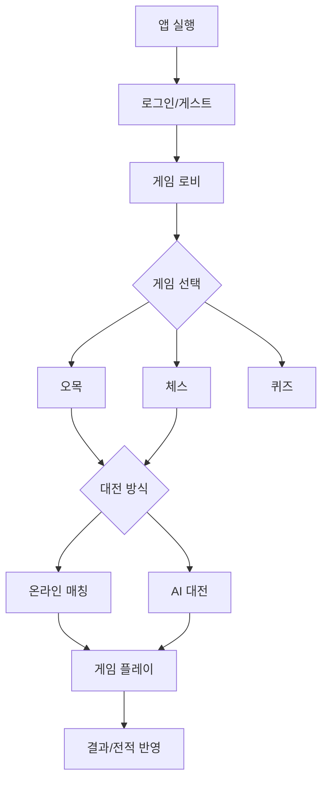

# PRD (Product Requirements Document) — 심심풀이

## 1. 문서 정보
| 항목 | 내용 |
|---|---|
| 프로젝트명 | 심심풀이 |
| 버전 | v0.1 (초안) |
| 작성자 | |
| 작성일 | 2026-10-10 |
| 최종 수정일 | |
| 상태 | 초안 / 검토중 / 승인 |

## 2. 개요 (Overview)
- **한 줄 요약**: 심심할 때 가볍게 즐기는 미니게임 모음 앱 (오목, 체스, 퀴즈 등)
- **배경 / 문제 정의**: 자투리 시간에 간단히 즐길 수 있는 보드게임·퀴즈를 한 앱에서 제공하고, 친구와 온라인 대전 또는 AI와 대결할 수 있는 서비스 부재
- **목표(Goal)**: 다양한 캐주얼 게임을 한 곳에서 즐기고, 온라인 매칭/AI 대전을 통해 재방문율과 체류시간을 높인다
- **비목표(Non-Goal)**: (이번 버전에서 하지 않을 것 명시, 예: 실시간 음성채팅, 결제/과금 시스템 등)

## 3. 타겟 사용자 & 페르소나
| 페르소나 | 특징 | 니즈 |
|---|---|---|
| 자투리시간 유저 | 출퇴근/대기시간에 짧게 플레이 | 빠른 매칭, 간단한 룰 |
| 보드게임 애호가 | 오목/체스를 전략적으로 즐김 | AI 난이도 선택, 랭킹 |
| 캐주얼 퀴즈 유저 | 가볍게 지식 테스트 | 다양한 주제, 짧은 세션 |

## 4. 핵심 기능 (Core Features)

### 4.1 공통
- [ ] 회원가입 / 로그인 (소셜 로그인 포함 여부)
- [ ] 게임 로비 (게임 선택 화면)
- [ ] 프로필 / 전적 / 랭킹
- [ ] 알림 (대전 신청, 매칭 성사 등)

### 4.2 오목 (Omok)
- [ ] 온라인 1:1 대전 (매칭/초대)
- [ ] AI 대전 (난이도: 하/중/상)
- [ ] 룰 기본값(렌주룰 등) 및 설정
- [ ] 대국 기록 저장 / 다시보기

### 4.3 체스 (Chess)
- [ ] 온라인 1:1 대전 (매칭/초대)
- [ ] AI 대전 (난이도별 엔진 레벨)
- [ ] 기보(PGN) 저장 / 다시보기
- [ ] 타이머(블리츠/스탠다드) 옵션

### 4.4 퀴즈 (Quiz)
- [ ] 카테고리별 문제 제공
- [ ] 싱글 플레이 모드
- [ ] 온라인 대결(실시간 점수 경쟁) 모드
- [ ] 오답노트 / 정답률 통계

### 4.5 확장 가능 영역 (향후 게임 추가 고려)
- 게임 모듈을 플러그인 형태로 추가할 수 있는 구조 고려 (TRD에서 상세화)

## 5. 사용자 흐름 (User Flow)

## 6. 화면 정의 (Screen List)
| 화면명 | 설명 | 우선순위 |
|---|---|---|
| 스플래시/로그인 | 앱 진입, 인증 | High |
| 로비(홈) | 게임 목록, 공지 | High |
| 오목 대전 화면 | 보드, 대전 UI | High |
| 체스 대전 화면 | 보드, 대전 UI | High |
| 퀴즈 화면 | 문제/답안 UI | High |
| 매칭 대기 화면 | 매칭 상태 표시 | High |
| 프로필/전적 | 전적, 랭킹, 설정 | Medium |
| 다시보기(리플레이) | 기보/기록 재생 | Low |

## 7. 비기능 요구사항 (Non-Functional Requirements)
- 성능: 실시간 대전 지연시간 목표 (예: < 200ms)
- 가용성: 동시 접속자 목표치 및 서버 다운타임 허용 기준
- 보안: 사용자 인증, 게임 조작(핵/치팅) 방지
- 호환성: iOS / Android / 웹 지원 범위

## 8. 성공 지표 (KPI / Success Metrics)
| 지표 | 목표치 |
|---|---|
| DAU / MAU | |
| 평균 세션 시간 | |
| 게임당 리텐션(D1/D7/D30) | |
| 온라인 매칭 성사율 | |
| AI 대전 승률 분포(밸런스 확인용) | |

## 9. 마일스톤 / 로드맵
| 단계 | 내용 | 기한 |
|---|---|---|
| MVP | 오목 AI/온라인, 체스 AI/온라인, 퀴즈 싱글 | |
| v1.0 | 퀴즈 온라인 대결, 랭킹 시스템 | |
| v1.x | 신규 게임 추가, 소셜 기능 강화 | |

## 10. 리스크 및 이슈
| 리스크 | 영향 | 대응 방안 |
|---|---|---|
| AI 엔진 구현 난이도(체스/오목 모두) | 일정 지연 | 오픈소스 엔진(Stockfish 등) 활용 검토 |
| 실시간 매칭 인프라 비용 | 운영비 증가 | 서버리스/매칭 큐 최적화 |
| 치팅/부정행위 | 신뢰도 하락 | 서버사이드 검증, 이상행동 탐지 |

## 11. 미해결 질문 (Open Questions)
- 수익모델 (광고/인앱결제/구독) 포함 여부?
- 게스트 플레이 허용 여부?
- 글로벌 서비스 vs 국내 한정?
