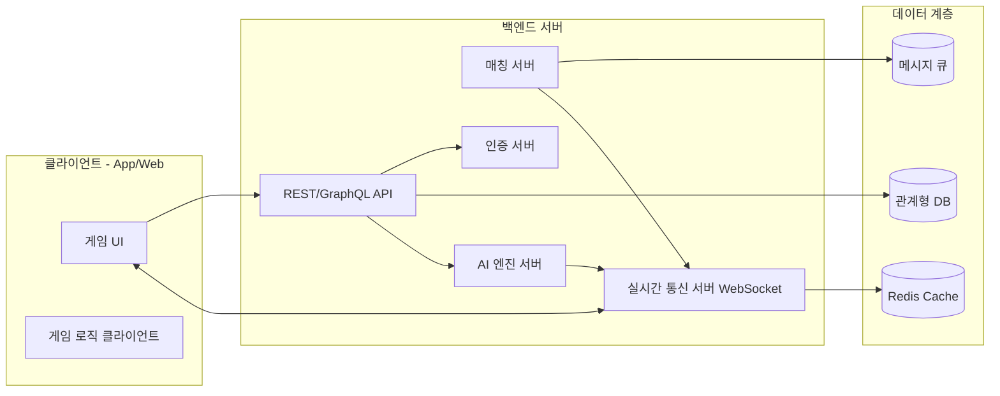
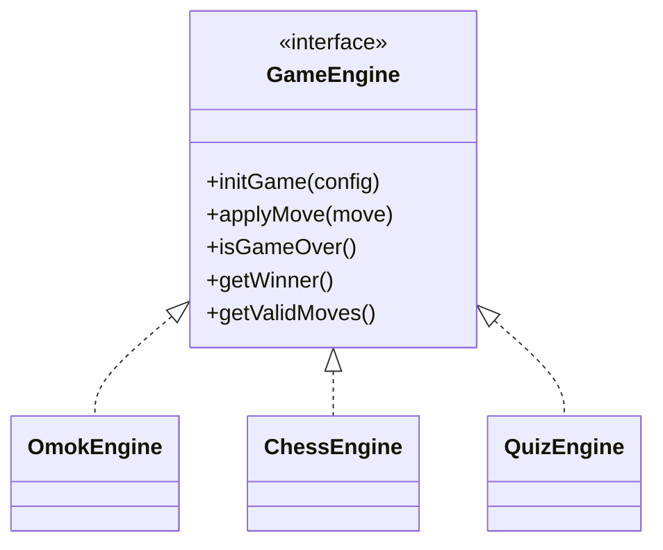
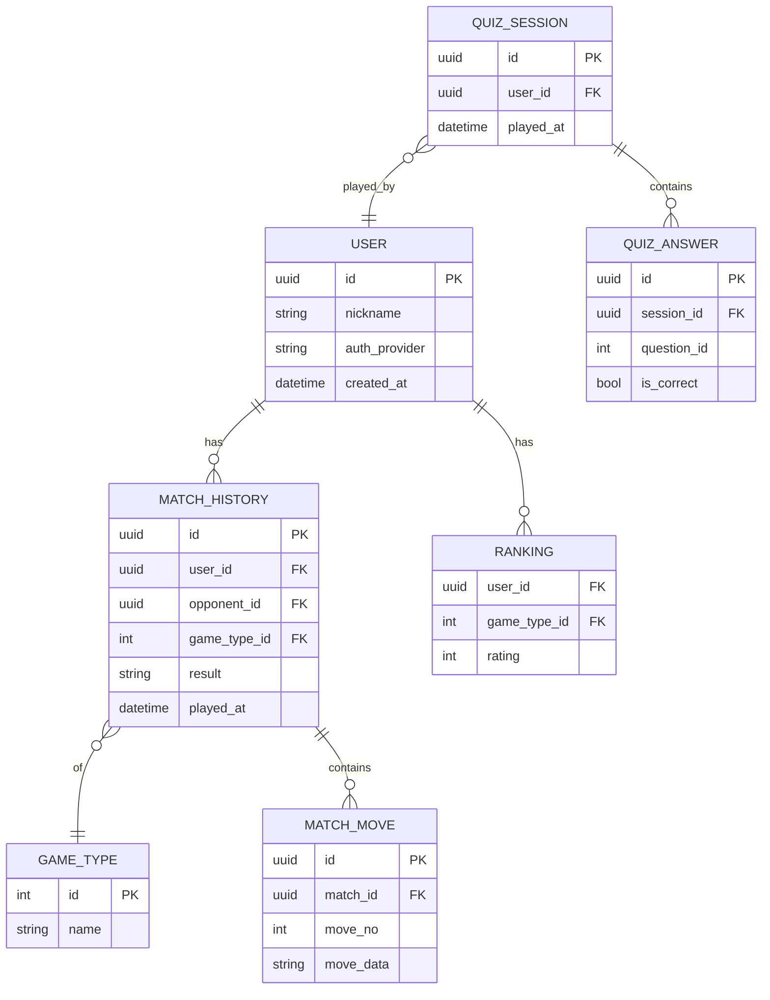

# TRD (Technical Requirements Document) — 심심풀이

## 1. 문서 정보
| 항목 | 내용 |
|---|---|
| 프로젝트명 | 심심풀이 |
| 관련 PRD | [PRD.md](./PRD.md) |
| 버전 | v0.1 (초안) |
| 작성자 | |
| 작성일 | 2026-10-10 |

## 2. 시스템 개요
- 멀티 게임(오목/체스/퀴즈)을 지원하는 클라이언트-서버 구조
- 실시간 대전(온라인 매칭)과 AI 대전을 모두 지원
- 게임별 모듈을 독립적으로 추가/확장 가능한 구조 지향

## 3. 전체 아키텍처

## 4. 기술 스택 (제안)
| 영역 | 후보 기술 | 비고 |
|---|---|---|
| 클라이언트 | Flutter / React Native / Unity(게임 특화) | 플랫폼 공통화 vs 게임 퍼포먼스 트레이드오프 |
| 백엔드 API | Node.js(NestJS) / Spring Boot / Go | 팀 숙련도 기준 선택 |
| 실시간 통신 | WebSocket(Socket.IO) / WebRTC(필요시) | 대전 동기화용 |
| 매칭 시스템 | Redis 기반 큐 / 전용 매칭 서비스 | ELO 기반 매칭 고려 |
| DB | PostgreSQL / MySQL | 전적, 유저, 랭킹 |
| 캐시 | Redis | 세션, 매칭 큐, 실시간 상태 |
| AI 엔진 - 체스 | Stockfish (UCI 엔진) | 난이도별 depth/skill level 조정 |
| AI 엔진 - 오목 | 자체 Minimax + Alpha-Beta / MCTS | 난이도별 탐색 깊이 조절 |
| 인증 | OAuth2 / Firebase Auth / 자체 JWT | 소셜로그인 연동 |
| 인프라 | AWS / Azure / GCP + Docker/Kubernetes | 오토스케일링 고려 |
| 모니터링 | Prometheus + Grafana / CloudWatch | 실시간 서버 상태 |

## 5. 게임 모듈 설계

### 5.1 공통 게임 모듈 인터페이스 (추상화)

- 신규 게임 추가 시 `GameEngine` 인터페이스 구현 + 클라이언트 렌더러만 추가하면 되도록 설계

### 5.2 오목
- 보드 상태: 15x15 배열
- 룰 엔진: 오목/렌주룰 승리 조건 판정 로직
- AI: Minimax + Alpha-Beta Pruning, 난이도별 depth 조정 (예: 하=2, 중=4, 상=6+)

### 5.3 체스
- 보드 상태: FEN 표기법 기반 관리
- 기보: PGN 저장
- AI: Stockfish 엔진 연동, UCI 프로토콜 통신, `Skill Level`/`Depth`로 난이도 제어

### 5.4 퀴즈
- 문제 데이터: DB 또는 외부 문제 API 연동
- 실시간 대결: 동시 출제 + 서버 타임스탬프 기반 정답/속도 판정

## 6. 실시간 대전 (온라인 매칭) 설계
- **매칭 로직**: ELO/MMR 기반 매칭, 대기시간 초과 시 범위 확대
- **상태 동기화**: 서버 권위(Server-Authoritative) 모델 — 클라이언트는 입력만 전송, 서버가 상태 검증 후 브로드캐스트
- **재접속 처리**: 연결 끊김 시 일정 시간 내 재접속 허용, 타임아웃 시 기권 처리
- **부정행위 방지**: 서버사이드 유효 수(move) 검증, 비정상 패턴 탐지

## 7. 데이터 모델 (초안 ERD)

## 8. API 설계 (초안)
| Method | Endpoint | 설명 |
|---|---|---|
| POST | /auth/login | 로그인 |
| GET | /games | 게임 목록 조회 |
| POST | /matches/queue | 온라인 매칭 큐 등록 |
| DELETE | /matches/queue | 매칭 취소 |
| WS | /ws/match/{matchId} | 실시간 대전 통신 |
| POST | /ai/{gameType}/move | AI 대전 수 요청 |
| GET | /users/{id}/history | 전적 조회 |
| GET | /quiz/questions | 퀴즈 문제 조회 |
| POST | /quiz/sessions/{id}/answer | 퀴즈 답안 제출 |

## 9. 비기능 요구사항 상세
| 항목 | 목표/기준 |
|---|---|
| 응답 지연(실시간 대전) | 평균 < 200ms |
| 동시 접속 처리 | 목표 동접자 수 명시 필요 |
| 가용성(SLA) | 99.x% |
| 확장성 | 게임 모듈 추가 시 서버 재배포 최소화 |
| 보안 | HTTPS, JWT 만료/갱신, Rate Limiting |
| 로깅/모니터링 | 매칭 실패율, AI 응답시간, 에러율 추적 |

## 10. 배포 / 인프라 전략
- 환경: Dev / Staging / Production 분리
- CI/CD: 빌드-테스트-배포 자동화 파이프라인
- 컨테이너화: Docker + Kubernetes(또는 매니지드 서비스)로 매칭/실시간 서버 오토스케일링
- AI 엔진 서버: 별도 스케일 유닛(CPU 집약적이므로 독립 스케일링 권장)

## 11. 테스트 전략
| 종류 | 대상 |
|---|---|
| 단위 테스트 | 게임 룰 엔진(승패 판정), AI 로직 |
| 통합 테스트 | 매칭 → 실시간 대전 → 결과 저장 플로우 |
| 부하 테스트 | 동시 매칭/대전 다수 발생 시나리오 |
| 보안 테스트 | 치팅/비정상 입력 방어 검증 |

## 12. 리스크 및 기술적 의사결정 필요 사항
- 클라이언트 프레임워크 선택 (크로스플랫폼 vs 네이티브/게임엔진)
- 실시간 통신 방식 (WebSocket vs WebRTC vs 게임 전용 서버)
- AI 난이도 설계 기준 (탐색 깊이 vs 반응속도 트레이드오프)
- 매칭 알고리즘 상세 (단순 랜덤 vs ELO 기반)

## 13. 미해결 질문 (Open Questions)
- 멀티플랫폼 지원 범위 (iOS/Android/Web 동시 여부)
- 서버 운영 예산 및 클라우드 벤더 선정
- 글로벌 서비스 시 리전별 서버 분산 필요 여부
